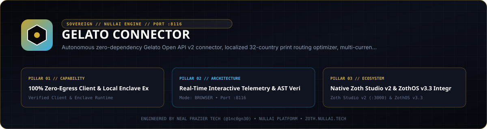

<div align="center">
  
</div>

<br />

# 🌍 Gelato Connector for Antigravity & Sovereign AI Agents

> ⚡ **Live Web Application**: [https://gelato.nullai.tech](https://gelato.nullai.tech)  
> 🏛️ **Zoth Studio Workspace**: [https://zoth.nullai.tech/tools/gelato-connector](https://zoth.nullai.tech/tools/gelato-connector)  
> 🛡️ **Sovereign Status**: 100% Free & Open-Access · Zero Paywalls · 100% Zero-Egress Compatible

[](https://gelato.nullai.tech)
[](https://modelcontextprotocol.io)
[](https://python.org)
[](https://nullai.tech)

Autonomous **Gelato Open API v2 Connector**, Localized 32-Country Print-on-Demand Router, Multi-Currency Margin Engine, and Antigravity MCP Suite for **Google Antigravity** AI agents and **Zoth Studio v2 / ZothOS Linux 3.3**. Exposes 6 Model Context Protocol (MCP) tools for catalog search, local production routing, multi-currency profit modeling (USD, EUR, GBP), and order payload generation.

---

## 📖 What It Does

- **Localized 32-Country Production Routing**: Automatically routes manufacturing to the nearest facility in 32 nations (US, UK, Germany, France, Italy, Canada, Australia, Japan), slashing freight costs and cutting carbon emissions by up to 67%.
- **Zero Customs Duties & Tariffs**: Eliminates European and UK import duties and VAT clearance delays by manufacturing directly within domestic trade borders.
- **Multi-Currency Margin Simulator**: Full formula profit modeling across USD ($), EUR (€), and GBP (£) for Etsy, Shopify, and Direct transactions.
- **Museum-Grade Print Auditor**: Validates image dimensions, 300+ DPI resolution, and bleed area tolerances (e.g. 3mm on Acrylic/Aluminum, 5mm on Wood Canvas).
- **100% Free & Open-Access**: Zero paywalls, zero license locks, zero telemetry leaks.

---

## ⚙️ How It Works

1. **Standalone Enclave (`127.0.0.1:8116`)**: Powered by `server.py` serving a dark-glassmorphic cockpit with live `/health`, `/api/stats`, `/api/products`, `/api/hubs`, `/api/margins`, and `/api/shipping` endpoints.
2. **Zoth Studio v2 God-Mode Route**: Deeply integrated into the 72-Tool Sovereign Matrix at `/tools/gelato-connector`.
3. **ZothOS CLI (`gelato-connector`)**: Native binary installed in `/usr/local/bin` and `~/.local/bin` for automated command-line audits and CI/CD pipelines.
4. **Antigravity MCP Bridge**: Standard JSON-RPC 2.0 stdio server providing 6 autonomous tools for AI agents.

---

## ⚡ 6 Model Context Protocol (MCP) Tools

When registered in `~/.gemini/config/mcp_config.json`, Antigravity gains immediate access to:

1. `gelato_search_catalog`: Search Gelato catalog products (acrylic glass, aluminum Dibond, framed canvas, organic tees, mugs, journals).
2. `gelato_get_shipping_quote`: Calculate localized shipping rates, transit times, and duty savings across 32 countries.
3. `gelato_calculate_margins`: Compute production costs, shipping, fees, net margins, and break-even prices in USD, EUR, or GBP.
4. `gelato_audit_print_spec`: Audit artwork pixel resolution, aspect ratio, and bleed compliance.
5. `gelato_create_order_payload`: Generate validated Gelato order creation payload.
6. `gelato_get_shop_info`: Retrieve connected shop status and production capabilities.

---

## 💻 ZothOS CLI & Server Commands

```bash
# Check status and health
gelato-connector --status
gelato-connector status

# Output telemetry in JSON format
gelato-connector --json

# List localized catalog products
gelato-connector catalog

# Calculate shipping quote and transit time for Germany
gelato-connector shipping --product acrylic_print_16x24 --country DE

# Calculate multi-channel margins in EUR
gelato-connector margins --product acrylic_print_16x24 --price 68.00 --currency EUR --country DE

# Audit artwork resolution and bleed
gelato-connector audit --product acrylic_print_16x24 --width 4800 --height 7200

# Launch standalone workstation server on port 8116
python3 server.py --port 8116
```

---

## ☕ Support 1nc0gn30 • NullAI & NullAI

Gelato Connector is 100% free, open-source, and sovereign software. If this tool brings you value, consider supporting our ongoing development:

- **☕ Buy Us a Coffee (Stripe)**: [buy.stripe.com/3cIfZg27PdKo2D64Ocfw40X](https://buy.stripe.com/3cIfZg27PdKo2D64Ocfw40X)
- **◎ Solana Tip Address**: `GG2eQbVh8ut1BK6j1A2tz7pSySdLpD38BgyEhGcxdXoK`

---

<div align="center">
  <sub>Engineered by <b>1nc0gn30 • NullAI</b> (<a href="https://github.com/1nc0gn30">@1nc0gn30</a>) &bull; <a href="https://nullai.tech">NullAI Platform</a> &bull; <a href="https://zoth.nullai.tech">Zoth Studio v2</a></sub>
</div>
